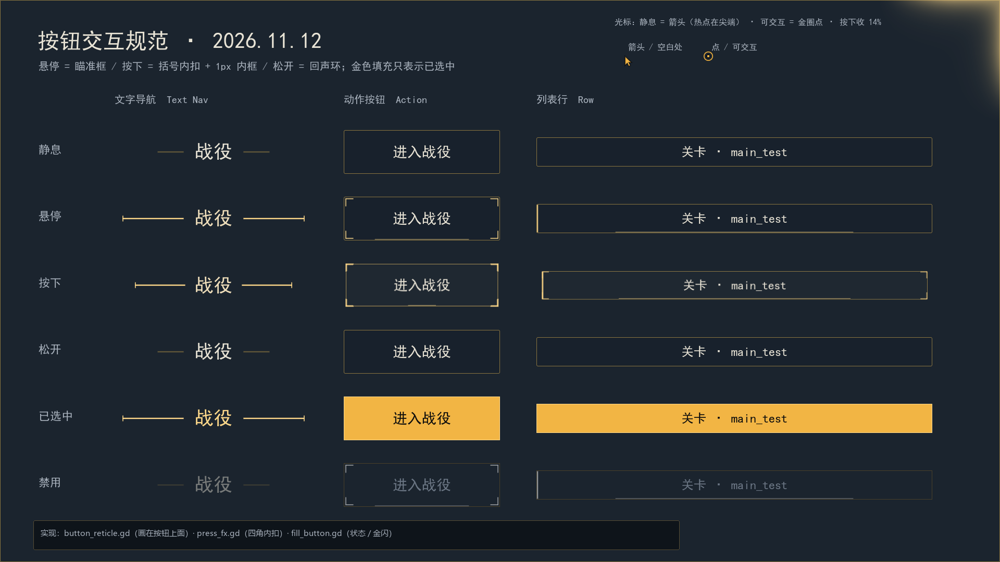
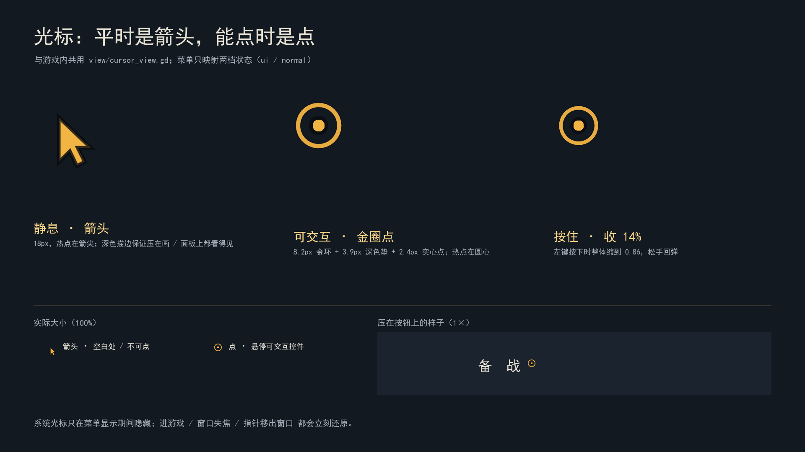
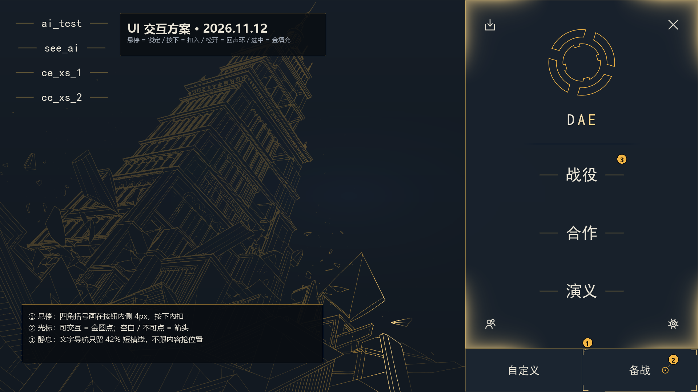

# 光标与按钮交互系统（2026.11.12）

> 范围：**PC / 鼠标**。本轮不做手机端交互改动。
> 两件事：① 主菜单用上游戏内的自绘光标（平时箭头、可交互变点）；② 所有按钮的悬停 / 按下 / 选中
> 换成一套统一的「瞄准框」语言。
>
> 图示见本文末尾：`ui_button_states.png`（组件状态总表）、`ui_cursor_states.png`（光标样张）、
> `ui_menu_after.png`（主菜单实景）。

---

## 1. 为什么现在要改

上一版按钮交互（2026.11.5）解决的是「悬停要有反馈」：四边向中心泛光、按下缩放、点击金闪。
实际看下来有五个问题：

1. **泛光没有形状**。深底 + 0.5 alpha 的四边渐变会糊成一圈毛边，四角最亮、中心不亮，
   远看只是「按钮在发虚」，读不出「瞄准了哪一颗」。
2. **泛光和文字抢对比度**。为了在深底上看得见，泛光被压到 0.5 alpha；而按钮文字正好在中心，
   悬停时整块亮度抬高，暖白小字反而更糊。
3. **按下是一整圈亮边**（`press_fx`）—— 一个完整矩形亮框盖在悬停泛光上，两种语言打架。
4. **文字导航按钮在按下那一帧就发 `pressed`**：页面立刻推走，玩家根本看不到「按下去」这一下，
   也失去了「按下后反悔、移出再松手」的标准取消手势。
5. **菜单没有光标反馈**：只有系统手型，和游戏内的金圈光标是两套语言。

---

## 2. 方案：瞄准框（Reticle）

一句话：**悬停不是「发光」，是「被瞄准」；按下不是「亮一圈」，是「扣进去」。**

这套语言只用了项目已有的三种视觉手段 —— 渐变暗底、1px 细线、几何图形 —— 没有新增颜色、
没有贴图、没有圆角花边。金色仍然只占 10%：悬停是**线**，选中才是**面**。

### 2.1 状态机

| 状态 | 触发 | 视觉 | 时长 / 曲线 |
|---|---|---|---|
| 静息 | — | 1px 暗金框（`line`）；文字导航只有 42% 短横线；图标按钮只有几何图标 | — |
| **悬停** | 指针进入可交互控件 | 四角 **L 形括号**：1.5px、臂长 14、内侧 4px；底边一条 1px 细线从中心向两侧长到 30% | 0.08s，ease-out |
| **按下** | 左键按下 | 括号**向内扣**到 1px、线宽加到 2px、补一圈 1px 内框；按钮整体 0.975；文字下沉 1px | 0.07s |
| **松开** | 指针仍在按钮内 | 外扩一圈 **回声环**（1.5 → 12.5px，alpha 0.50 → 0）；缩放回弹 1.004 → 1 | 0.34s / 0.16s |
| **已选中** | 页签 / 开关 / 面板已打开 | 金色**自下而上填满**（保持原语义），字自动翻成近黑；文字导航：横线 100% + 两端竖线 + 整字亮金 | 0.12s |
| **禁用** | `disabled` | 括号和文字换灰；光标仍是箭头（不可交互）；悬停只给灰括号 | 0.08s |

> **金色只表示「已选中 / 已启用」这条口径没有变。** 悬停不再填金；点击的 0.18s 金闪保留为
> 「一次性确认」，它不改变选中状态，也不改字色。

### 2.2 按控件形状分五种变体

同一套状态，按几何形状换画法，避免「四角括号在窄条上变成四个噪点」：

| 变体 | 判定 | 悬停 | 按下 |
|---|---|---|---|
| **按钮** | 宽 < 高 × 4 | 四角括号 + 底边细线 | 括号内扣 + 1px 内框 |
| **列表行** | 宽 ≥ 高 × 4 | 左缘 2px 竖条（中间先亮，按下长满）+ 底边细线 | 左缘竖条加粗 |
| **文字导航** | 无底纹（`menu_text_button`） | 短横线 42% → 100%，两端各补一根 10px 竖线：`\|— 战役 —\|`；字色向亮金偏 35% | 横线回缩 18%、文字下沉 1px；**松手才发 pressed** |
| **图标按钮** | 56×56（退出 / 返回 / 载入 / 好友 / 设置） | 图标外四角括号；图标本身变亮金 | 括号内收 4px + 加粗 |
| **小方块** | 宽高都 < 96（命令卡 / 科技九宫格 / 设置齿轮） | 括号**贴着 1px 边框**画（inset 1、臂长 10）—— 命令卡左上角有 12px 的 Q/W/E 键位，括号不能压上去 | 同上，向内收 0.5px |

### 2.3 光标

| 状态 | 画法 |
|---|---|
| 静息 | **主题金箭头**，18px 高，热点在箭头尖；深色描边保证在画和面板上都看得见 |
| 可交互 | **金圈点**：8.2px 金环 + 3.9px 深色垫底 + 2.4px 实心金点（热点在圆心） |
| 按住 | 整体缩到 0.86 |
| 窗口失焦 / 指针移出 | 立刻把系统光标还回去，不会「桌面上没有鼠标」 |
| 菜单关闭（进游戏） | 释放系统光标；游戏内那套攻击 / 建造 / 无效光标接手 |

判定「可交互」走 `Viewport.gui_get_hovered_control()`，再按下面四条收口：

1. 必须是 `MOUSE_FILTER_STOP` 的控件（铺满屏幕的遮罩不算）；
2. `BaseButton` 且没有 `disabled`；
3. 自己声明了非箭头光标（文字按钮 / 列表行 / 角按钮都这么标）；
4. 文本输入（`LineEdit` / `TextEdit`）也算。

所以主菜单四角的三角命中区、列表行、被禁用按钮，都能得到正确的一档，而不是「系统手型到处乱变」。

---

## 3. 实现落点

| 文件 | 作用 |
|---|---|
| `view/menu_cursor.gd` | 菜单光标层（`layer=500`，挂在 main 上）：箭头 / 点 / 按下 / 失焦还原 |
| `view/cursor_view.gd` | 两档画法：箭头（18px，热点尖端）+ 金圈点；按住缩 14% |
| `view/start_screen.gd` | 创建光标；`close()` 释放、`open_menu()` 接管；`_exit_tree()` 兜底 |
| `view/button_reticle.gd` | **瞄准框层**：画在按钮**上面**的括号 / 底边线 / 内框 / 回声环 |
| `view/fill_button.gd` | 每帧把 `glow / press / pulse / grey` 喂给瞄准框；金闪 / 填充保持原逻辑 |
| `view/press_fx.gd` | 按下不再画整圈亮边，改成四角向内扣的短角 |
| `view/menu_text_button.gd` | 两端竖线 + 按压态 + **松手确认** + 选中整字亮金 |
| `view/menu_corner_button.gd` / `view/menu_back_button.gd` | 图标外四角括号；按住内扣 |
| `view/theme.gd` / `data/config.json` | 配色不变；新增 `ui.button_style` / `ui.reticle_*` / `ui.menu_cursor_scale` |

### 3.1 为什么瞄准框要单独一层

`fill_button` 的动画器是 `show_behind_parent` —— 它画在按钮底纹**下面**（为了让金色填充
不糊住文字）。而括号现在画在按钮**内侧** 4px，会被不透明的 `normal` 底纹盖住。

所以 `button_reticle.gd` 是一颗**普通子节点**（画在父节点之后），只画四角与边缘，
不碰中心文字。这样无论按钮有没有透明 hover 底纹，括号都在。

> 备选方案是画在按钮外侧；但主菜单底部动作条、HUD 底栏都是贴屏幕边缘的，
> 外侧没有像素可画，会被裁掉。内侧 + 上层是唯一在所有布局里都成立的画法。

### 3.2 配置

`data/config.json` 的 `ui` 段新增（都可以热改，不改代码）：

| 键 | 默认 | 含义 |
|---|---|---|
| `button_style` | `"reticle"` | `"glow"` = 回旧的四边泛光（排查用） |
| `reticle_arm` | `14.0` | 括号臂长（6~28px） |
| `reticle_gap` | `2.0` | 括号内缩的基准（实际 = 本值 + 2px；按下收到 1px；小方块固定贴边框） |
| `reticle_width` | `1.5` | 静息线宽（按下自动 +0.5） |
| `reticle_alpha` | `0.85` | 括号最亮不透明度 |
| `reticle_underline` | `0.30` | 底边细线最大长度占按钮宽度的比例（0 = 不画） |
| `menu_cursor_scale` | `1.0` | 菜单光标整体缩放 |

---

## 4. 验证

### 4.1 自动测试

| 套件 | 断言 | 结果 |
|---|---|---|
| `test_fill_button` | 悬停 / 按下 / 填充 / 金闪 / 字色 / 隐藏清理 | **200 / 200** |
| `test_button_style` | 瞄准框挂载、状态同步、文字按钮松手确认 / 取消 | **16 / 16** |
| `test_menu_cursor` | 可交互判定（按钮 / 禁用 / 自绘手型 / 文本输入 / 隐藏 / IGNORE） | **13 / 13** |
| `test_start_flow` | 入场 → 主菜单 → 进游戏 → 回菜单 | **61 / 61** |
| `test_menu_deck` | 页面切换 / 侧栏 / 返回 | **39 / 39** |
| `test_menu_hover_touch` | 桌面悬停 / 触屏按住两套口径 | **21 / 21** |
| `test_menu_corner_buttons` | 四角三角命中 + 图标 | **105 / 105** |
| `test_hover_fill` | 悬停不填金 / 选中才填 | **120 / 120** |
| `test_press_fx` | 按下 / 回弹 / 失焦清理 | **35 / 35** |

**全量**（最终一轮）：`tools/run-tests.ps1` 跑 **122** 个文件 / **11604** 条断言，
**11592 通过 / 12 失败**；只有 2 个文件失败，都是工作区已有的数据问题：

- `test_ai_test_campaigns`（11）—— AI 战役 / 难度数据与断言不一致（见 `feel_optimization_plan.md` 的记录）；
- `test_unit_traits`（1）—— 「未知兵种回退到默认 4 条特性」。

> `test_menu_glow_fade` 是帧率敏感的（「雕版右缘贴主面板左缘」只有 2px 容差，低帧率下会差一帧）；
> 最终一轮 **48/48 通过**，但在机器负载高时曾失败过一次 —— HEAD 也一样，不是本轮改动引入的。

### 4.2 渲染图



*组件总表：文字导航 / 动作按钮 / 列表行 × 静息 / 悬停 / 按下 / 松开 / 已选中 / 禁用。*



*光标：箭头（空白处）与金圈点（可交互），以及按下收缩。*



*主菜单实景：悬停「战役」+ 可交互光标。*

---

## 5. 怎么重新出图

三张图都是 Godot **实机渲染**（1920×1080），不是手绘：

```powershell
$godot = "C:\D\GodotEngine\gd4.7.2mono\Godot_v4.7.2-stable_mono_win64_console.exe"
# 组件总表
& $godot --path dev_gd_a/daeem --script res://tests/capture_kit.gd --resolution 1920x1080
# 主菜单实景（选中 + 悬停 + 光标）
& $godot --path dev_gd_a/daeem --script res://tests/capture_button_states.gd --resolution 1920x1080
# 光标样张
& $godot --path dev_gd_a/daeem --script res://tests/capture_cursor_sheet.gd --resolution 1920x1080
# 组装成 docs 里的三张图（加标注 / 页脚）
python .ui-preview/compose_docs.py
```

> 截图脚本写到 `dev_gd_a/daeem/_shot_*.png`，已在 `.gitignore` 里，跑完可以不管。

---

## 6. 明确没做的部分

- **手机端**：按用户口径不碰。触屏仍然走「按住 = 亮、松开 = 灭」，系统光标不隐藏。
- **旗帜 / 卡片类对象**（`menu_banner` 的关卡旗）：它们不是矩形按钮，悬停仍靠旗面自身
  的金线变化；硬套四角括号会和旗形打架。光标仍然会变成点。
- **金闪**：保留为「一次性确认」。如果下一轮希望「点击只留回声环、不再金闪」，
  只需把 `fill_button._on_pressed_flash()` 关掉（`set_click_flash(false)` 已可按按钮关）。
- **HUD 按钮**：`fill_button` 的挂载点全覆盖（命令卡 / 科技 / 页签 / 部队行 / 选项 / 结算 /
  地图选择 / 备战），所以它们会自动用上瞄准框；本轮没有逐屏截 HUD 的图。
